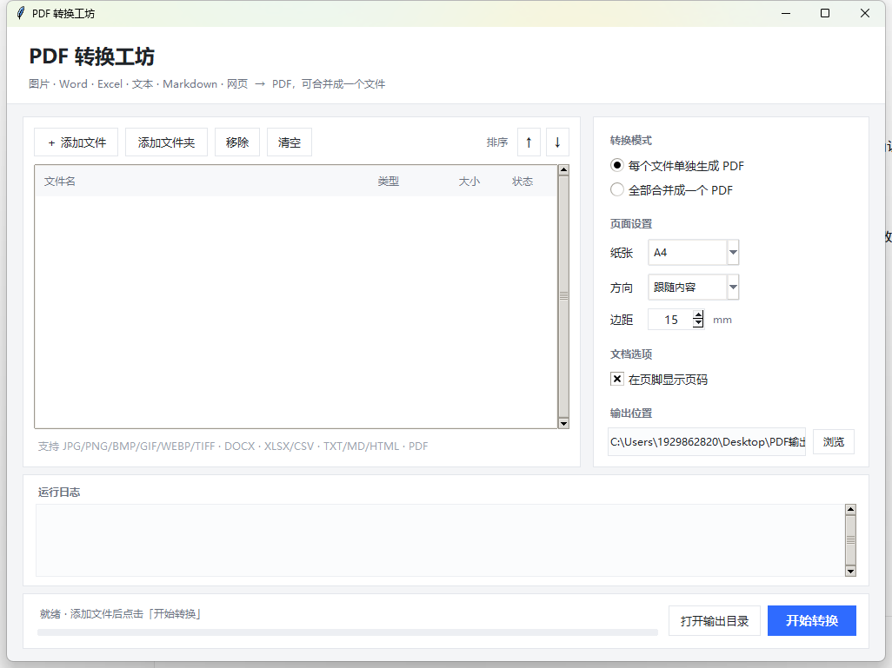

# PDF 转换工坊

一个开箱即用的 Windows 桌面工具：把 **图片 / Word / Excel / 文本 / Markdown / 网页** 批量转成 PDF，
可以一个文件一个 PDF，也可以全部合并成一份。**纯本地运行，不联网、不上传。**



## 功能

| 输入 | 处理方式 |
| --- | --- |
| JPG / PNG / BMP / GIF / WEBP / TIFF | 一张图一页，等比缩放居中；透明底自动铺白；多页 TIFF 逐页输出 |
| Word `.docx` | 保留标题层级、粗体 / 斜体 / 下划线 / 字体颜色、项目符号、表格、内嵌图片、分页符 |
| Excel `.xlsx` / `.xlsm` / `.csv` | 每个工作表独立成页，表格自动分页并重复表头，列宽按内容自适应 |
| TXT / LOG / INI / JSON | 自动识别 UTF-8 / GBK / UTF-16 编码 |
| Markdown `.md` | 标题、列表、引用、代码块、表格、行内格式、本地图片 |
| HTML `.htm` | 标题、段落、列表、表格、代码块、本地图片 |
| PDF | 直接加入列表，在合并模式下按顺序合并 |

界面能力：文件排序、批量添加文件夹、纸张（A4/A3/A5/Letter/原始尺寸）、
横竖版（含「跟随内容」自动判断）、页边距、页脚页码、独立或合并输出、
重名自动加后缀不覆盖。

## 快速开始

### 方式一：直接用打包好的程序（推荐）

1. 到 [Releases](../../releases) 下载 `PDF.zip`（约 29 MB）并解压；
2. 进入 `PDF转换工坊` 文件夹，双击 `PDF转换工坊.exe`（使用说明在同目录）。

> 必须保留同目录下的 `_internal` 文件夹，那是运行库。
> 采用文件夹版而非单文件版，是因为单文件版启动时要解压到 `%TEMP%`，
> 在临时目录不可写的机器上会直接报错。

### 方式二：从源码运行

```bash
git clone https://github.com/boys506/pdf-converter.git
cd pdf-converter

python -m venv .venv
.venv\Scripts\activate
pip install -r requirements.txt

python src/main.py
```

也可以直接双击 `运行源码.bat`，它会自动建虚拟环境并安装依赖。

## 自己打包 exe

```bash
pip install pyinstaller
pyinstaller --noconfirm --onedir --windowed --name "PDF转换工坊" ^
  --icon icon.ico --paths src src/main.py
```

或双击 `build_exe.bat`。产物在 `dist/PDF转换工坊/`。

## 项目结构

```
src/
  main.py        tkinter 界面：文件列表、参数面板、进度与日志
  engine.py      调度：单文件转换、批量、合并
  images_pdf.py  图片 → PDF
  office_pdf.py  Word / Excel / CSV → PDF
  text_pdf.py    TXT / Markdown / HTML → PDF（含简易 HTML 解析器）
  docbuild.py    排版公共件：样式表、文档模板、页脚页码
  fonts.py       中文字体注册与回退链
  utils.py       页面尺寸、路径、编码识别等工具
  selftest.py    打包后自检（--selftest）
tests/
  make_samples.py   生成各格式样本并回归转换
  offline_check.py  禁用 socket 后跑全流程，验证纯离线
```

## 实现要点

- **排版**：reportlab Platypus（`BaseDocTemplate` + `Frame`），中文按 `wordWrap="CJK"` 断行。
- **中文字体**：注册 `msyh.ttc` / `msyhbd.ttc` 并嵌入 PDF；缺失时依次回退
  等线 → 宋体 → 黑体 → PDF 内置 CID 字体（`STSong-Light`），因此中文不会乱码。
- **代码块与行内代码**：含中文时自动从等宽字体切回中文字体，避免缺字形。
- **离线**：全项目无 `requests` / `socket` / `urllib` 等任何联网调用，
  `tests/offline_check.py` 会在 socket 被禁用的前提下跑完整转换来证明这一点。
- **健壮性**：合并用的中间文件放在输出目录而非 `%TEMP%`；输出重名自动加 `_1`、`_2`。

## 已知限制

- 不支持 `.doc` / `.xls` / `.ppt` / `.pptx`（旧版二进制格式），需先另存为新格式。
- Word 的复杂版式（分栏、文本框、页眉页脚、艺术字）会被简化。
- HTML 只做文本级解析，不渲染 CSS 布局；纯前端渲染的页面可能提取不到内容。
- 仅支持 Windows（依赖系统字体目录与 `os.startfile`）。

## 自检

```bash
PDF转换工坊.exe --selftest
```

会在程序目录生成 `自检结果.txt`，逐项报告各类文件转换与合并是否正常。

## License

未指定。若要开源，建议补一份 [MIT](https://choosealicense.com/licenses/mit/) 或 Apache-2.0 许可证。
